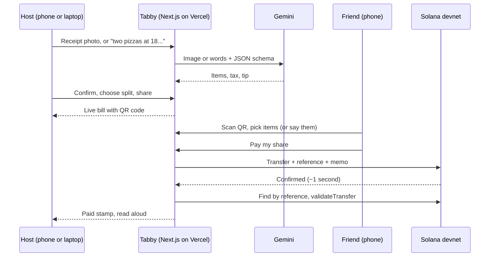

# Tabby

**Snap the receipt. Everyone pays their part.**

Tabby is for the moment after a group dinner, a ski trip, or a shared grocery run, when one person has paid for everyone and now has to collect. The host snaps the receipt (or just says what everyone had), friends scan a QR code, tap what was theirs, and pay their exact share in about a second. Payments settle on Solana, every one carries an on-chain receipt, and the bill stamps itself **Settled** when the last person pays.

No app to install, no accounts, no math, no chasing.

**Live demo:** [hackknight.vercel.app](https://hackknight.vercel.app) (Solana devnet, test money only)

Built in one weekend at **Hack Knight Fall 2026** (Queens College).
Submitted to **Best Financial Hack**, **MLH Best Use of Solana**, **MLH Best Use of Gemini API**, and **MLH Best Use of ElevenLabs**.

---

## The problem

Splitting a shared bill is a small payment problem that happens constantly, and it's still awkward. One person fronts the whole check. Then come the screenshots of the receipt, the tax-and-tip math done by hand on a phone calculator, the "who had the guac?" debate, and a week of reminders in the group chat. Often the person who paid quietly eats the difference rather than chase anyone.

The tools people use today make this worse in specific ways. Payment apps don't know what anyone ordered, so someone has to do the math first. Transfers between different apps don't connect. And the person collecting has no single place that shows who has paid and who hasn't.

## What Tabby does

**For the person who paid (the host)**

- **Three ways to start.** Take a photo of the receipt and Gemini reads every line, the tax, and the tip. Or tap the mic and just say it: *"Two pizzas at 18 each, wings for 12, 20% tip, split four ways. I'm Sam and I paid."* Or type the items in.
- **A receipt check.** After a photo scan, Tabby compares what it read against the total printed on the receipt and flags any mismatch, so a misread line doesn't silently cost someone money.
- **Two ways to split.** By what each person had (shared dishes divide automatically between everyone who had them), or evenly between a set number of people.
- **A live bill.** A QR code friends can scan, a progress bar, and a list of who has paid. Paid stamps land in real time, and the bill reads each payment out loud ("Ana just paid Sam back 27 dollars and 21 cents").
- **Gentle follow-up.** One tap sends the bill to the group chat for friends who weren't at the table. **Remind** writes a polite message with each person's exact amount and opens Messages, WhatsApp, or email with it filled in, or records a friendly voice note to send instead.
- **Your tabs.** Every bill you've hosted on this device, with what's been collected and what's still owed.

**For everyone else**

- Scan the QR code, type a name, and tap what was yours. Or tap the mic and say *"I had the burrito and half the guac,"* in any language, and Tabby finds those items for you to confirm.
- See exactly what you owe: your items, your share of anything you split, and your proportional share of tax and tip.
- Pay in one tap. The payment settles in about a second, and you get a link to the on-chain proof.

## How we used each technology

### Solana: settlement and proof

Every repayment is a real token transfer on Solana devnet, from the friend to the host. We use **Solana Pay** conventions throughout: each payment request gets a unique `reference` address, and the server finds the transaction carrying that reference and runs Solana Pay's `validateTransfer` to confirm the right amount reached the right wallet before marking anyone paid. There is no custom smart contract and no database flag a person could flip; "Paid" means the chain says so.

Each payment also carries an **on-chain memo** such as `Tabby: Ana paid Sam back · Weekend ski trip`, so the receipt is readable by anyone on Solana Explorer, not just inside our app.

There are three ways to pay, so nobody gets stuck: a one-tap payment that needs no wallet (for the demo, our server funds a one-time wallet with test tokens and signs for it), **Pay with Phantom** (our server builds the transaction and the guest's wallet signs it), and a standard **Solana Pay QR** any compatible wallet can scan.

Why Solana for this: shared bills are small, frequent payments between friends. Settlement in about a second at a fraction of a cent means paying back $12.04 is as easy as tapping a button, and the public record removes any "did you get my payment?" back-and-forth.

### Gemini: understanding receipts and people

Gemini does three jobs, all using **structured output** (a JSON schema) so the app receives data it can check rather than free text:

1. **Reading receipts.** A photo becomes line items, tax, tip, and the printed total.
2. **Tabby AI.** A conversation becomes a bill. It asks for missing prices instead of guessing, understands percentages, quantities ("two pizzas at 18 each" becomes two $18 lines so two people can each claim one), even splits, and who paid, and it replies in the language you used.
3. **"Tell Tabby what you had."** A guest's words are matched to the bill's actual item IDs. Gemini can only choose from items that exist, and the guest confirms before anything is claimed.

We never let the model do arithmetic that matters. Gemini reports "8% tax" as a percentage and our code computes the dollars; every price is validated before it's used.

### ElevenLabs: voice in and voice out

- **Speech to text (Scribe)** powers the mic in Tabby AI and in "Tell Tabby what you had." It detects the spoken language automatically, so people can talk in whatever language they're comfortable with.
- **Text to speech** reads payments aloud on the live bill and records reminder voice notes. The server writes every sentence from real bill data, so the voice can't be made to say arbitrary text.

## How it works, in one picture



More detail: **[Architecture](docs/ARCHITECTURE.md)** · **[How the split is calculated](docs/SPLIT_MATH.md)**

## Getting it running

You'll need Node 20+, a free Supabase project, a Gemini API key, and (optionally) an ElevenLabs key.

```bash
npm install --legacy-peer-deps
cp .env.example .env.local      # then fill it in
npm run devnet init             # creates the devnet test token
npm run dev
```

Then run `supabase/schema.sql` and both files in `supabase/migrations/` in the Supabase SQL editor. The full walkthrough, including every environment variable, deploying to Vercel, and funding demo wallets, is in **[Setup](docs/SETUP.md)**.

## Documentation

| Guide | What's in it |
| --- | --- |
| [Architecture](docs/ARCHITECTURE.md) | How the pieces fit, the data model, the three payment paths, how payments are verified, and the security model |
| [How the split is calculated](docs/SPLIT_MATH.md) | The exact rules for items, shared dishes, tax, tip, leftovers, even splits, and rounding, with a worked example |
| [Setup](docs/SETUP.md) | Local development, database, devnet test money, deployment, and troubleshooting |
| [API reference](docs/API.md) | Every endpoint, what it expects, and what it returns |
| [Demo guide](docs/DEMO.md) | The pitch script, a pre-demo checklist, and backup plans |

## Project structure

```
app/
  page.tsx                  Home and review screens (host)
  bill/[id]/page.tsx        Live bill (host)
  bill/[id]/claim/page.tsx  Guest screen
  history/page.tsx          Your tabs
  settings/page.tsx         Profile
  components/               Tabby AI chat, guest voice matching, reminder panel, QR, shared hooks
  api/                      Server routes: receipts, AI, voice, bills, payments
lib/
  split.ts                  All split math (pure functions, no I/O)
  solana.ts, transfer.ts    Solana Pay URLs, transaction building, on-chain verification
  payments.ts               Shared logic for every way to pay
  assistant.ts              Cleans and checks Tabby AI's draft bills
  ratelimit.ts, ai.ts       Abuse protection and graceful AI fallbacks
supabase/                   Schema and migrations
scripts/setup-devnet.mjs    Creates and funds the devnet test token
```

## What we'd build next

- **Real money.** Switch from a devnet test token to USDC on mainnet, with a cash-out path to a bank account.
- **Automatic reminders.** Let guests leave a phone number or email so Tabby can nudge them itself.
- **Running balances.** Track who owes whom across many tabs with the same friends, settled in one payment.
- **More than one payer.** Handle the night where one person paid for dinner and another paid for drinks.

## Team

Built by **Faizan Khan**, **Tobiloba Onabanjo**, and **Mohamed Awad**.

## License

Copyright 2026 Faizan Khan, Tobiloba Onabanjo, and Mohamed Awad.

Licensed under the [Apache License, Version 2.0](LICENSE). You may use, modify, and share this code, including commercially, as long as you keep the license and copyright notices and note any changes you make. See [NOTICE](NOTICE) for attribution.
