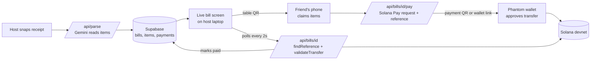

# Tabby

**Snap the receipt. Everyone pays their part.**

Tabby splits a restaurant bill in seconds. The host photographs the receipt, Gemini reads every line item, and friends at the table scan a QR code, tap what they ordered, and pay their exact share with Solana Pay. Payments settle in about a second for a fraction of a cent, and the bill updates live as each person pays.

Built in 48 hours at **Hack Knight Fall 2026** (Queens College).

Tracks: Best Financial Hack · MLH Best Use of Solana · MLH Best Use of Gemini API

---

## The problem

Splitting a bill is awkward. One person fronts the whole check, then spends a week chasing friends on payment apps, doing tax and tip math by hand, and quietly eating the difference. Shared bills are small, frequent payments between friends, and the tools for them are either slow to settle or take a fee.

## What Tabby does

1. **Snap.** The host takes a photo of the receipt. Gemini turns it into line items, tax, and tip. The host can fix anything that was misread before sharing.
2. **Share.** The host's laptop shows the bill and a QR code for the table.
3. **Claim.** Each friend scans the QR code, enters their name, and taps the items they ordered. Tax and tip are split in proportion to what each person ordered, so nobody does math.
4. **Pay.** Each person taps "Pay my share," approves the payment in their Phantom wallet, and it lands on Solana in about a second.
5. **Settle.** The host's screen stamps each person **Paid** the moment their payment confirms, with a running total of how much has been collected.

## Why Solana

- **Near-zero fees.** A $9 share costs a fraction of a cent to send, so small, frequent payments between friends make sense.
- **Instant settlement.** Payments confirm in about a second, fast enough to watch happen at the table.
- **Verifiable payments.** Each payment request carries a unique `reference` address. Tabby finds the exact transaction on-chain and checks it paid the right amount to the right wallet, with no payment processor in the middle.
- **No custom smart contract needed.** Solana Pay transfer requests move money directly from each friend's wallet to the host's wallet.

## Architecture



### How a payment is verified

1. When someone taps "Pay my share," the server computes their share, generates a fresh random `reference` address, and saves a pending payment in Supabase.
2. It builds a Solana Pay URL containing the recipient (host wallet), the amount, the token, and that reference. The phone shows it as an "Open in wallet" link and a QR code.
3. The wallet sends a token transfer that includes the reference address.
4. Every couple of seconds, the bill endpoint calls `findReference` to look for a transaction carrying that reference, then `validateTransfer` to confirm the amount and recipient. If both pass, the payment is marked paid and the transaction signature is stored.

## Tech stack

| Layer | Technology |
|---|---|
| Frontend and API | Next.js 15 (App Router), React 19, TypeScript |
| Receipt reading | Google Gemini (`@google/genai`) with a structured JSON schema |
| Payments | Solana Pay v1 (`@solana/pay`, `@solana/kit`) on devnet |
| Database | Supabase (Postgres) |
| Devnet tooling | `@solana/web3.js`, `@solana/spl-token` |
| RPC | Helius devnet RPC |

---

## Running it locally

You need Node 20 or newer (`node -v` to check) and a Phantom wallet.

### 1. Install

```bash
git clone https://github.com/jellyfishing2346/hackknight.git
cd hackknight
npm install --legacy-peer-deps
cp .env.example .env.local
```

Ignore the "vulnerabilities" warning after install, and don't run `npm audit fix --force`. It upgrades packages to breaking versions.

### 2. Fill in `.env.local`

| Variable | Where to get it |
|---|---|
| `GEMINI_API_KEY` | aistudio.google.com/apikey (use a personal Google account; school accounts often block it) |
| `GEMINI_MODEL` | Leave as `gemini-3.8-flash` |
| `SUPABASE_URL` | Supabase → Connect, or Project Settings → Data API → Project URL |
| `SUPABASE_SERVICE_ROLE_KEY` | Supabase → Project Settings → API Keys → **secret** key (`sb_secret_...`) or legacy **service_role**. Not the publishable or anon key. |
| `SOLANA_RPC_URL` | helius.dev → switch to **Devnet** → RPCs → copy the URL |
| `MERCHANT_WALLET` | The host's Phantom address (Receive → Solana → Copy), with Testnet Mode on and Solana Devnet selected |
| `SPLIT_TOKEN_MINT` | Printed by `npm run devnet init` in step 4 |

Each variable should appear only once, and each URL should contain `https://` only once.

### 3. Create the database tables

In Supabase, open **SQL Editor → New query**, paste the contents of `supabase/schema.sql`, and click **Run**. You should see "Success. No rows returned," and **Table Editor** should list `bills`, `items`, and `payments`.

### 4. Create the test money

The app uses its own devnet token as a stand-in for USDC, so demo wallets can be topped up without limits.

```bash
npm run devnet init
```

The first run creates an admin wallet (saved to `.devnet-admin.json`) and prints its address. The automatic airdrop is almost always rate-limited, so fund it by hand:

1. Open **faucet.solana.com** in Safari or a private window (browser extensions can block its bot check and grey out the button).
2. Sign in with GitHub for a higher limit.
3. Paste the admin address, choose **Devnet** and **2.5 SOL**, and click **Confirm Airdrop**. Wait for "Airdrop successful."
4. Check it arrived: `npm run devnet balance <admin address>`

Then run `npm run devnet init` again and paste the printed `SPLIT_TOKEN_MINT=...` line into `.env.local`.

### 5. Run

Keep the app running in one terminal and use a second terminal (the **+** in VS Code's terminal panel) for everything else.

```bash
npm run dev
```

Open http://localhost:3000 and click **Use a sample receipt** to try the flow without a photo.

---

## Setting up demo wallets

Each wallet that will pay needs a little devnet SOL for fees and some test tokens.

1. In Phantom, create an account for paying (avatar → Add Account → Create New Account). Turn on Settings → Developer Settings → **Testnet Mode** and select **Solana Devnet**.
2. Copy its address: **Receive → Solana → Copy**. Send it to your laptop.
3. Fund it, replacing the address with the real one:
   ```bash
   npm run devnet fund 7xKX...fulladdress 200
   ```
   You should see `Sent 0.05 SOL and 200 test tokens to ...`

To pay: on the claim screen, tap **Pay my share**, then in Phantom tap the **scan** icon, scan the payment QR, and approve. Payment QR codes work even when the app runs on localhost, because they only carry payment details and the phone sends the transaction straight to Solana.

### Phones joining the table

The table QR points at the app's own address, so phones can't open it while the app runs on `localhost`. For a real table demo, deploy to Vercel: import the GitHub repo, add every variable from `.env.local` under **Settings → Environment Variables**, and deploy. Open the bill from the Vercel URL, and phones can scan the table QR.

---

## Project structure

```
app/
  page.tsx                     Host screen: snap or type the receipt, review, share
  bill/[id]/page.tsx           Live bill screen for the laptop on the table
  bill/[id]/claim/page.tsx     Phone screen: claim items, see your share, pay
  components/useBill.ts        Polls the bill every 2 seconds
  components/QR.tsx            Renders QR codes
  api/parse/route.ts           Receipt photo → Gemini → line items, tax, tip
  api/bills/route.ts           Create a bill and its items
  api/bills/[id]/route.ts      Bill state; checks Solana for pending payments
  api/bills/[id]/pay/route.ts  Create a Solana Pay request for one person's share
  api/items/[id]/claim/route.ts Claim or release an item
lib/
  split.ts                     Share math: items plus proportional tax and tip
  solana.ts                    Payment URLs, references, on-chain verification
  bills.ts                     Loads a bill from Supabase
  supabase.ts                  Server-side Supabase client
  types.ts                     Shared types
scripts/setup-devnet.mjs       Devnet token creation, wallet funding, balances
supabase/schema.sql            Database tables
```

## API reference

| Method and route | Body | Returns |
|---|---|---|
| `POST /api/parse` | `{ image: base64, mimeType }` | `{ merchant, items: [{ name, price }], tax, tip }` |
| `POST /api/bills` | `{ title, tax, tip, items }` | `{ id }` |
| `GET /api/bills/:id` | — | `{ bill, items, payments }`; also marks newly confirmed payments as paid |
| `POST /api/bills/:id/pay` | `{ name }` | `{ payment, url }` where `url` is the Solana Pay link |
| `POST /api/items/:id/claim` | `{ name, claim: true or false }` | `{ ok: true }`, or 409 if someone else claimed it |

## Keeping secrets safe

`.gitignore` excludes `.env.local` (all API keys) and `.devnet-admin.json` (the admin wallet's private key). Verify with:

```bash
git check-ignore -v .env.local .devnet-admin.json
```

Share keys with teammates by direct message only. If a key is ever pushed or posted publicly, generate a new one in that service's dashboard and delete the old one; removing it from GitHub isn't enough because it stays in the history.

---

## Troubleshooting

| Problem | Fix |
|---|---|
| `zsh: event not found` | zsh treats `!` as special. Run commands one line at a time, or avoid `!` in pasted commands. |
| `unzip: cannot find or open Users/...` | Paths need a leading `/` or `~`, for example `~/Downloads/file.zip`. |
| `The airdrop was rate-limited` / `429 Too Many Requests` | Use faucet.solana.com by hand (step 4), or ask a mentor to send 1 devnet SOL to the admin address. Helius free accounts don't do airdrops. |
| Faucet **Confirm Airdrop** button stays grey | Select an amount, re-paste the address with no spaces, or open the faucet in Safari or a private window. |
| `Error: Non-base58 character` | The command still has placeholder text. Paste a real Solana address. |
| `Set MERCHANT_WALLET in .env.local` | Fill in the host's Phantom devnet address and save the file. |
| Site stops loading after running another command | That terminal was running `npm run dev`. Restart it and use a second terminal for other commands. |
| "Couldn't read the receipt" | Try a flatter, brighter photo, or tap **Type it in instead**. Every item can be edited on the review screen. |
| Payment approved but never marked Paid | Check the host wallet received tokens with `npm run devnet balance <MERCHANT_WALLET>`. Make sure `SOLANA_RPC_URL` is the Helius devnet URL, and check the `npm run dev` terminal for errors. |
| Phantom won't scan or shows the wrong network | Turn on Testnet Mode and select Solana Devnet, and make sure the funded account is the one selected. |

---

## What's next

- Splitting a single item between several people
- Real USDC on mainnet, with a one-tap onboarding flow for friends without a wallet
- Saved groups and running balances for roommates and recurring dinners
- Settle-up reminders and payment history

## Team

- Faizan Khan
- Teammate 2
- Teammate 3
- Teammate 4
