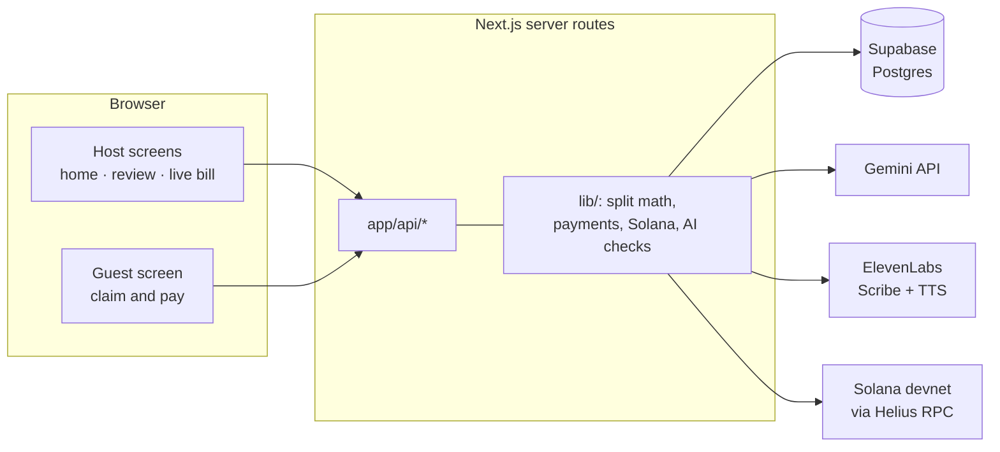
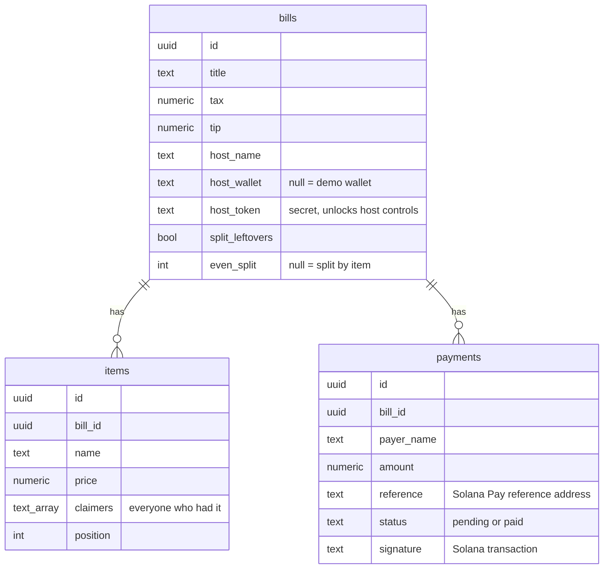

# Architecture

Tabby is a single Next.js app (App Router, React 19, TypeScript) deployed on Vercel. The browser never talks to Gemini, ElevenLabs, Supabase, or Solana directly for anything sensitive: every call goes through a server route, which holds the keys, checks the request, and decides what's allowed.

## The main pieces

**Screens** (`app/`)

| Screen | Who sees it | Purpose |
| --- | --- | --- |
| `page.tsx` | Host | Start a bill (photo, voice, or typing), review and fix it, choose the split, share |
| `bill/[id]/page.tsx` | Host (anyone can view) | The live bill: QR code, who has paid, host controls, reminders, read-aloud |
| `bill/[id]/claim/page.tsx` | Guests | Enter a name, claim items (by tapping or by voice), pay |
| `history/page.tsx` | Host | Every bill hosted on this device |
| `settings/page.tsx` | Anyone | Name and optional wallet, remembered on this device |

The live bill and guest screen poll the bill every two seconds (`useBill.ts`). Polling was a deliberate choice over websockets: it's simple, works everywhere Vercel runs, and two-second freshness is plenty for people at a table.

**Server logic** (`lib/`)

- `split.ts` is all the money math, as pure functions with no network or database access. Every screen and every server route computes amounts through it, so the number a guest sees, the number they're charged, and the number the host sees can't drift apart. See [How the split is calculated](SPLIT_MATH.md).
- `payments.ts` is the one place that decides what someone owes and creates a payment request. All three ways of paying go through it.
- `solana.ts` builds Solana Pay URLs and verifies payments on-chain. `transfer.ts` builds and sends transactions.
- `assistant.ts` turns Tabby AI's draft into a clean bill: it drops items without prices, expands quantities into separate lines, and computes percentage tax and tip itself.
- `ratelimit.ts` and `ai.ts` protect the shared budgets and turn AI outages into friendly messages.

## Data model

Three tables in Supabase Postgres (`supabase/schema.sql` plus the two migrations):

A few decisions worth explaining:

- **Items hold a list of claimers**, not a single owner, so a shared dish is just an item with two names on it. Claiming and unclaiming go through a Postgres function, `claim_item`, which updates the list atomically. Two friends tapping the same dish at the same moment can't overwrite each other.
- **Payments start as `pending`** and only become `paid` after the server verifies the transaction on Solana. A guest's browser can't mark itself paid.
- **There are no user accounts.** Guests are identified by the name they type for that bill. That keeps joining to one step, which matters more at a dinner table than identity does. The guardrails below cover the obvious problems this creates.

## How a payment works

Every way to pay starts the same way. The guest asks to pay; `preparePayment` works out what they still owe using `split.ts`, and creates a payment row with a fresh, random **reference** address (or reuses an open one for the same amount, so a double tap doesn't create two). The reference is the key idea from Solana Pay: it's an extra, read-only account attached to the transfer instruction, which makes this exact payment findable on-chain without trusting anything the browser says.

Then one of three paths sends the money:

| Path | Who signs | When it's used |
| --- | --- | --- |
| **One tap** (`/instant`) | The server | The default, no wallet needed. For the demo, the server creates a one-time wallet, mints it exactly the share in test tokens, and sends the transfer, with the admin wallet paying fees. |
| **Pay with Phantom** (`/tx` then `/send`) | The guest's wallet | The server builds an unsigned transaction, Phantom signs it, the server submits it. |
| **Solana Pay QR** (`/pay`) | The guest's wallet | A standard `solana:` URL any Solana Pay wallet can scan and pay. |

Every transaction is shaped the same way: optional setup instructions, then a **memo** (`Tabby: Ana paid Sam back · Weekend ski trip`), then the **transfer**, which carries the reference. Order matters: Solana Pay's `validateTransfer` treats the last instruction as the transfer and ignores earlier instructions unless asked to check a memo. We verified this against the library's own validation code, with and without the memo.

### How a payment is verified

When anyone loads the bill, the server checks every pending payment:

1. `findReference` looks up the transaction that includes the payment's reference address.
2. `validateTransfer` confirms the transfer went to the host's token account, in the right token, for at least the right amount, and that the reference matches.
3. Only then does the payment become `paid`, with its signature stored so anyone can open the proof on Solana Explorer.

Because verification reads the chain directly, it doesn't matter which path was used or whether the guest closed their browser. If the money arrived, the bill says so.

## Using AI safely

Each Gemini call uses a **JSON schema** for its response, and the server treats the result as untrusted input:

- **Receipts:** item names and prices are validated, and anything without a finite price is dropped. The printed total is kept separately and used only to warn the host when the items don't add up.
- **Tabby AI:** the model reports tax and tip as percentages when the user said percentages; `assistant.ts` does the arithmetic. Quantities become separate lines, with any leftover cent on the last line, so totals are exact.
- **Guest matching:** the model can only return item IDs from the bill's own list, the server drops anything else, and the guest confirms before any claim is made.

When Gemini is out of quota or overloaded, `ai.ts` recognizes it and each feature responds with a calm message pointing to the manual option (typing items in, or tapping them), instead of an error that looks like the app is broken.

## Security and abuse protection

This is a hackathon project running on test money, but we still designed it so the obvious abuses don't work:

- **Host controls need a secret.** Creating a bill returns a random host token, stored only on the host's device. Host actions (claiming for the host, splitting leftovers, changing the even split) require it.
- **Names can't be hijacked.** A guest can't take the host's name, and joining with a name that's already on the bill asks "Is that you?" first.
- **Paid shares are locked.** Once someone has paid, their items can't be released, nobody else can join an item they've paid for, and the host can't change the split. Nobody's share can change after the fact.
- **The voice can't be scripted.** Read-aloud announcements and reminder voice notes are written by the server from real bill data. A request can choose *which* event to announce, never the words.
- **Rate limits.** Each visitor has a per-minute limit on receipt scans, AI chats, guest matching, voice transcription, announcements, one-tap payments, and bill creation, so one person or script can't drain the shared AI credits or the demo wallet. Limits are counted per server instance: enough to stop a single abuser during a demo, though not a hard global cap.
- **Keys stay on the server.** Supabase is accessed with a service key from server routes only, and the admin wallet's secret never leaves the server.

## What we'd change for production

- Replace the one-tap demo path (which mints test tokens) with real wallet payments in USDC, or a card on-ramp for people without a wallet.
- Add optional accounts so balances, history, and reminders can follow a person across devices.
- Move rate limiting to a shared store (such as Redis) so limits apply across all server instances.
- Replace polling with a realtime subscription once there are many people watching each bill.
